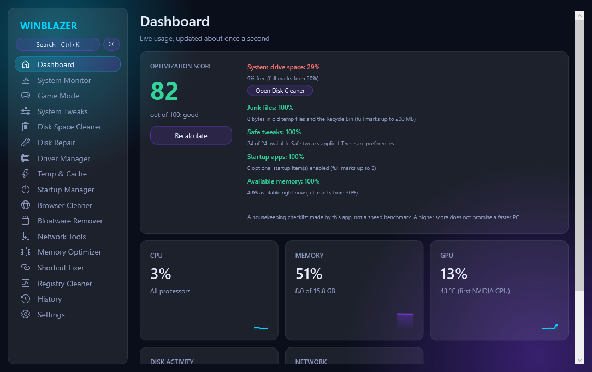

# WinBlazer (Beta)


**Take charge of your Windows PC.** Cleanup, tuning, monitoring and repair tools in one dashboard, with backups or
undo for many of its changes.



> ## ⚠️ BETA: still in testing
> **This is an early beta. Expect bugs, and use it at your own risk.** WinBlazer can permanently delete files and change Windows settings. So far
> it has been tested on one PC, running an evaluation edition of Windows 11 IoT Enterprise LTSC. It has not had an
> independent security audit. **Back up important files before using it.**

WinBlazer does not promise a faster PC. Many tweaks make little or no measurable difference, and registry cleaning
rarely improves speed.

## What it does

| Area | What you can do |
|---|---|
| **Dashboard and System Monitor** | See processor, memory, disk, network and NVIDIA graphics activity, and end a program |
| **Cleanup** | Clear temporary files, caches and the Recycle Bin, see what uses disk space, and set up automatic cleaning |
| **Browser Cleaner** | Clear selected browser data and some Windows activity traces |
| **Game Mode** | Apply temporary settings while you play, then restore them |
| **System Tweaks** | Turn individual Windows settings on or off |
| **Startup Manager** | Choose what starts with Windows |
| **Memory Optimizer** | View memory use, free cached memory and limit background apps |
| **Network Tools** | Test ping, DNS and download speed, and change network settings |
| **Disk Repair** | Run Windows' repair and drive tools, and view drive health data |
| **Driver Manager** | List drivers, check for updates and back up third-party drivers |
| **Bloatware Remover** | Uninstall selected built-in apps |
| **Shortcut Fixer** | Find and repair broken shortcuts |
| **Registry Cleaner** | Remove certain broken registry entries, after saving a backup |
| **History** | See a record of what the app has done |

Each feature has limits. See [the details](docs/DETAILS.md).

## Requirements
- 64-bit Windows 11, or Windows 10 version 2004 or newer. Only the Windows 11 edition named above has been tested.
- Administrator permission to install (not needed for the portable ZIP), and for some features.
- NVIDIA graphics readings and settings need an NVIDIA card.

## Download and install
Choose one way. All downloads are on the
**[WinBlazer 0.1.0 beta release page](https://github.com/metalmike17/WinBlazer/releases/tag/v0.1.0)**.

| Way | Best for | Administrator features |
|---|---|---|
| [1. Installer](#1-installer-recommended) | Most people | Yes |
| [2. Portable ZIP](#2-portable-zip-no-installation) | Trying it without installing | No |
| [3. PowerShell](#3-powershell) | Downloading and checking the installer with commands | Yes |
| [4. Build it yourself](#4-build-it-yourself) | Developers, or running the code you have read | Yes |

### 1. Installer (recommended)
Download `WinBlazer-0.1.0-beta-Setup.exe` and run it. The .NET files it needs are included.

**The installer is not code-signed.** Windows may show **"Windows protected your PC"** and an unknown publisher, and
some PCs or security tools may block it. Only run it if you downloaded it from the link above and you trust it. If you
do, choose **More info**, then **Run anyway**. Do not turn off your antivirus to install it.

To check that your copy matches the published one, run this in PowerShell and compare the result with the SHA-256
value on the release page:
```
Get-FileHash .\WinBlazer-0.1.0-beta-Setup.exe -Algorithm SHA256
```

The app is installed in `Program Files\WinBlazer` with a Start menu shortcut, and a desktop shortcut if you tick it.
The program file is named `PCOptimizer.exe`, after the app's earlier name. To update, close WinBlazer and run the
newer installer.

### 2. Portable ZIP (no installation)
1. Download `WinBlazer-0.1.0-beta-portable.zip`.
2. Extract the whole ZIP to a folder you will keep.
3. Run `PCOptimizer.exe` inside it. The .NET files it needs are included. It is not code-signed either.

Before choosing this one:
- **Features that need administrator rights are not available.** Do not use **Run as administrator** on it, because
  other programs may be able to change the files in its folder.
- It does not keep everything in its folder. Settings, history and backups go to `%LOCALAPPDATA%\PCOptimizerNet`,
  shared with an installed copy.
- If automatic cleaning or Game Mode is on, do not move, rename or delete the folder.
- The ZIP holds the same app files as the installer, but **starting it from an extracted folder has not been tested.**

SHA-256 of the ZIP:
```
a5ecea262ec6788c988f853439716d4c434c14319491451ae22ad5eba5eeb5e0
```

### 3. PowerShell
This downloads the same installer into your Downloads folder, and starts it only if it matches the published file.
Open a normal PowerShell window and paste:
```powershell
$file = "$env:USERPROFILE\Downloads\WinBlazer-0.1.0-beta-Setup.exe"
Invoke-WebRequest "https://github.com/metalmike17/WinBlazer/releases/download/v0.1.0/WinBlazer-0.1.0-beta-Setup.exe" -OutFile $file -UseBasicParsing
if ((Get-FileHash $file -Algorithm SHA256).Hash -eq "69444d1114fd79e58ab81ce9af63f1e16d45b1823108db14bd09b329ca03555d") {
    Start-Process $file
} else {
    Write-Warning "The file does not match the published one. Do not run it."
}
```
**Windows may not show its "Windows protected your PC" warning for a file downloaded this way.** The installer is
still not code-signed. A match means you have the published file, not that it is guaranteed safe.

### 4. Build it yourself
This needs the [.NET 10 SDK](https://dotnet.microsoft.com/download/dotnet/10.0) and an internet connection to
download build components. The .NET tools collect usage data by default; Microsoft explains
[how to opt out](https://aka.ms/dotnet-cli-telemetry).

1. Download this project (**Code > Download ZIP**) and extract it, or clone it.
2. Read [`scripts\Install.ps1`](scripts/Install.ps1) if you want to see what it does. Only install code you trust.
3. In a normal PowerShell window (not as administrator) in the project folder, with WinBlazer closed, run:
   ```
   powershell -ExecutionPolicy Bypass -File scripts\Install.ps1
   ```
   `-ExecutionPolicy Bypass` lets this one run of the script start even if your PC blocks scripts.
4. Approve the Windows administrator prompt.

The installer (ways 1 and 3) and the build script both install to the same folder, so use only one of them.

## Before you use it
- **Read each confirmation.** If you are not sure what something does, leave it off.
- **Cleanup is permanent.** Deleted files, emptied Recycle Bin items and cleared browser data cannot be restored by
  WinBlazer. Clearing cookies usually signs you out of websites.
- **Removing an app deletes its local data.** Reinstalling may not be possible on every PC.
- **Ending a program can lose unsaved work.**
- **Do not turn off the PC during repairs or driver installs.** Back up first.
- A disk or drive health result is not a guarantee. If you suspect a failing drive, back up your files right away.

## What can be undone

| Change | How to go back | Limits |
|---|---|---|
| System Tweaks | **Restore** or **Reset to Defaults** | Restores what you had before, not factory settings. Values changed since are left alone |
| Game Mode | Restores when you turn it off or the followed game closes | Closed apps reopen without their earlier options. A power plan it created stays |
| Startup Manager | **Undo** | Keeps the last 20 changes |
| Shortcut Fixer | **Undo** | Newest change first. Never overwrites a newer file |
| Registry Cleaner | **Restore** | Newest backup only. Adds back what is missing and does not overwrite existing values |
| DNS and TCP/IP settings | Restore buttons in Network Tools | Restores what was saved before the first change |
| Driver updates | Device Manager, **Roll Back Driver** | Not always available. Third-party drivers are copied first |
| Removed apps | **Reinstall** | May need the Microsoft Store. Deleted app data does not come back |
| Cleanup and browser data | **No undo** | |
| Winsock reset | **No undo** | May affect VPN or security software |
| SFC, DISM, disk repair and drive optimizing | **No undo** | These are Windows' own tools |

**Uninstalling WinBlazer does not undo its changes.** Restore anything you want to restore first.

## Administrator use
Open WinBlazer normally. When a feature needs more permission, use its **Restart as administrator** button.

- Only the installed copy in `Program Files` can restart this way. Do not use **Run as administrator** on a copy in
  any other folder, because other programs may be able to change its files.
- Restore records for changes made as administrator are kept in folders that only administrators can change. An
  administrator copy restores only from those. Game Mode also keeps a copy in your user folder, so that it can
  restore without administrator rights, for example after a restart.
- Startup Manager's **Undo** covers changes made the same way: as administrator, or without. A Game Mode session
  started without administrator rights must be restored without them.
- As administrator, Shortcut Fixer's **Undo** covers shortcuts shared by all users. Open the app normally to undo
  changes to your own.
- An administrator copy does not follow folder links that were created without administrator rights, including
  ones you made yourself. This protection does not extend to other programs the app starts.
- If you enter a different account's password at the prompt, per-user features apply to that account.

## Internet use and privacy
WinBlazer's code has no analytics, advertising or usage tracking, and no feature that uploads your logs. These
features use the network. As with any connection, the service you reach can see your IP address.

| Feature | What it contacts |
|---|---|
| **Ping** (when you start it) | The server you enter; `1.1.1.1` (Cloudflare) is filled in to begin with |
| **DNS speed test** (when you start it) | Sends lookups for common websites to the DNS providers being compared, including your current one |
| **Download speed test** (when you start it) | `speed.cloudflare.com`; can use up to about 500 MB of data |
| **Check for driver updates** (when you start it) | Windows Update. With an NVIDIA card, also NVIDIA's website: the app downloads its product list, then sends numbers identifying your card model, whether you use Windows 10 or 11, and an English language code |
| **Install a driver** | Windows Update |
| **Repair Windows files (DISM)** | Windows may download repair files from Microsoft |
| **Website and Store links, app reinstall** | Opens your browser or the Microsoft Store, or asks Windows to reinstall the app |
| **Changing DNS** | Afterward, Windows sends your website lookups to the provider you chose |

Windows and the services above have their own privacy policies.

## Where your data is kept

| Folder | Contents |
|---|---|
| `%LOCALAPPDATA%\PCOptimizerNet` | Settings, history, logs and your own backups |
| `%ProgramData%\PCOptimizerNet-AdminBackups` | Originals for some administrator changes. Everyone on the PC can read it |
| `%ProgramData%\PCOptimizerNet-RegistryBackups` | Administrator registry backups |

Driver backups go in the folder you choose.

**Logs, backups and screenshots can contain your user name, file names, installed apps and network details.** Check
them before sharing.

## Uninstall
1. In the app, turn off automatic cleaning and Game Mode, and restore any changes you want to undo.
2. Close WinBlazer.
3. If you used the installer, open Windows **Settings > Apps > Installed apps** and uninstall **WinBlazer (beta)**.
   If you built it yourself, run this in a normal PowerShell window in the project folder:
   ```
   powershell -ExecutionPolicy Bypass -File scripts\Install.ps1 -Uninstall
   ```

For the portable ZIP, delete its folder after steps 1 and 2.

Your settings, logs and backups are kept. Delete the folders above yourself only when you no longer need to restore
anything.

## Known issues
- When a disk check says an offline repair is needed, the app does not offer `chkdsk /spotfix`. Its **Fix** button
  runs `chkdsk /f`.
- Times in repair logs end in `Z` (universal time), although they may show your local time.
- Disk check, system repair and drive optimizing results are read from English messages. For anything the app does
  not recognize, read the log.
- Another program could stop WinBlazer from opening by imitating its check for an already open copy.

## Reporting problems
Open an issue on this project with what you did, what you expected, what happened and your Windows version. The app
saves unexpected errors to `crash.log`; check it for personal details before attaching it.

**Security problems:** please do not post the details publicly. Use **Report a vulnerability** on the project's
**Security** tab. If that button is missing, open an issue that only asks for a private way to get in touch.

## License
[MIT](LICENSE). The software comes with no warranty.

WinBlazer is an independent project. It is not made or endorsed by Microsoft or NVIDIA. Windows is a trademark of
Microsoft.
